# MPC Heater Lab

<p align="center">
  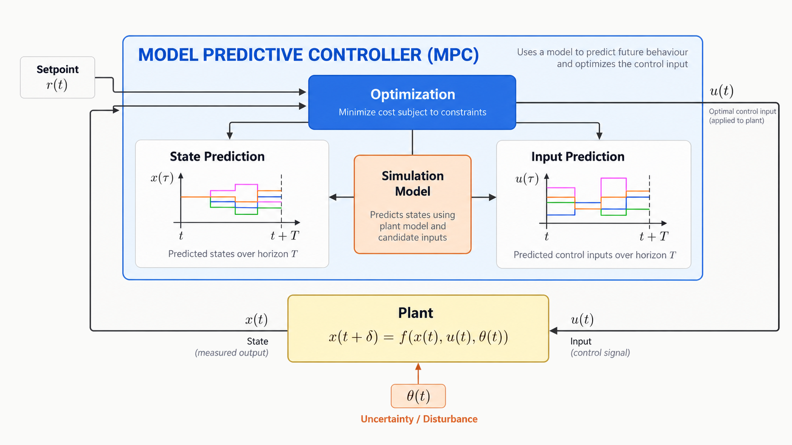
</p>

<p align="center">
  <strong>Offset-free MPC vs hand-tuned PID vs optimised PID on a heat-balance heater model.</strong>
</p>

<p align="center">
  <a href="#quick-start"><b>Quick start</b></a> ·
  <a href="#interactive-app"><b>Interactive app</b></a> ·
  <a href="#showcase-video"><b>Video</b></a> ·
  <a href="docs/EXPLAINER.md"><b>Explainer</b></a> ·
  <a href="docs/THEORY.md"><b>Theory</b></a> ·
  <a href="HOW-IT-WORKS.md"><b>How it works</b></a> ·
  <a href="report/report.md"><b>Report</b></a>
</p>

Three scripted scenarios, a multipage Streamlit lab (precomputed UI data for fast opens), batch plots under `results/`, and an 82 s showcase video driven by the same simulation JSON as the app.

## Quick start

```bash
python3 -m venv .venv && source .venv/bin/activate
pip install -r requirements.txt
pip install -e ".[dev]"
python3 -m pytest -q
python3 examples/run_simulations.py
python3 scripts/precompute_ui_data.py
streamlit run app.py
```

### Deploy

- **Streamlit Community Cloud** — full interactive lab. Align with
  [file organization](https://docs.streamlit.io/deploy/streamlit-community-cloud/deploy-your-app/file-organization)
  and [app dependencies](https://docs.streamlit.io/deploy/streamlit-community-cloud/deploy-your-app/app-dependencies):
  - **Main file:** `app.py` (repo root; multipage via `st.navigation` + `ui_pages/`).
  - **Dependencies:** root `requirements.txt` only (no `packages.txt`; no `-e .` —
    Cloud installs PyPI packages from that file; `app.py` adds `src/` to `sys.path`
    so `mpc_core` imports resolve).
  - **Python:** Advanced settings → **3.12** (matches `.python-version`). On 3.13/3.14,
    Cloud may build numpy/scipy/pandas from source and hang. To change Python after
    deploy: delete the app and redeploy with 3.12 selected.
  - After a push that fixes imports, use **Reboot app** (or redeploy) so the new
    entrypoint and requirements are picked up.
- **Vercel** — static mirror under `web/` (same charts/presets from precomputed `data/ui`). Streamlit itself does not run on Vercel, so deploy from the `web/` folder (a separate Vercel project that is **not** set to Python):

```bash
python scripts/sync_web_data.py
cd web
vercel --prod
```

Live static deploy: [web-six-gamma-97x4joejhv.vercel.app](https://web-six-gamma-97x4joejhv.vercel.app/). Do not run `vercel` from the repo root against the Python-linked `model-predictive-control` project — that path still expects an ASGI/`app` export.

## Interactive app

Theme: `.streamlit/config.toml` (cobalt accent `#2F6FEB`). Regen shots with the app running: `python scripts/capture_streamlit_screenshots.py`.

### Overview

Landing page with the same MPC loop diagram and short paths into the lab.

<p align="center">
  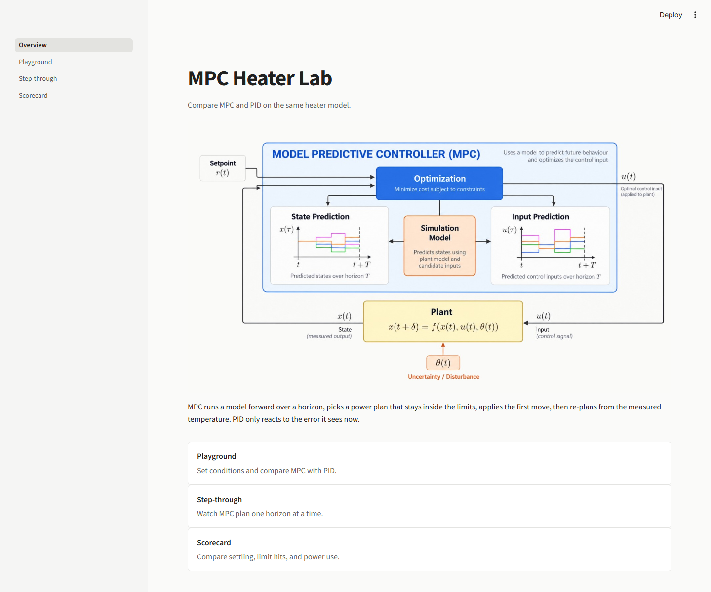
</p>

### Playground

Compare MPC, PID, and optimised PID on one chart. Presets load from disk. Cold open is the tight-power case.

<p align="center">
  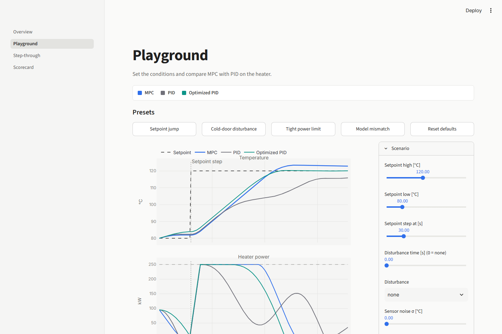
</p>

#### Playground presets

| Setpoint jump | Cold-door disturbance |
| :---: | :---: |
| 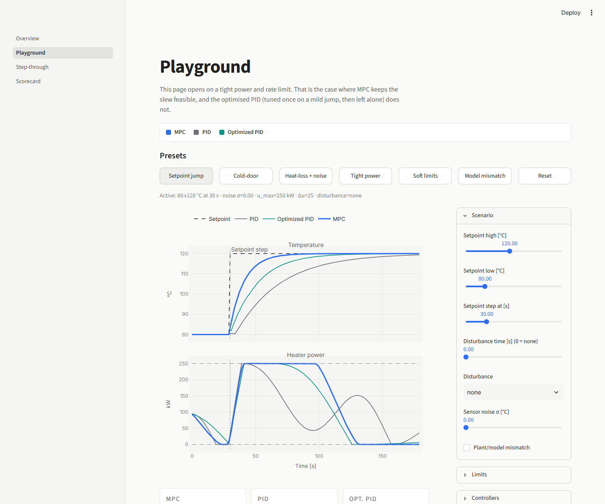 | 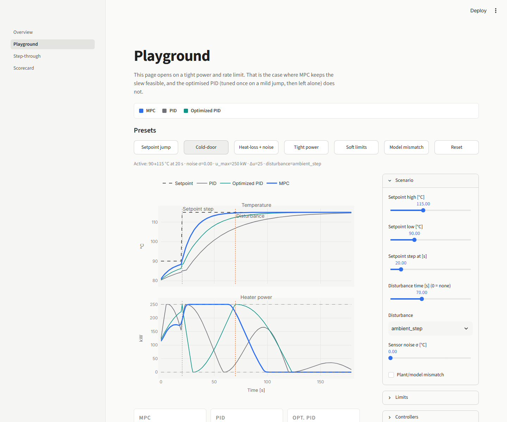 |

| Heat-loss bump + sensor noise | Tight power / rate limits |
| :---: | :---: |
| 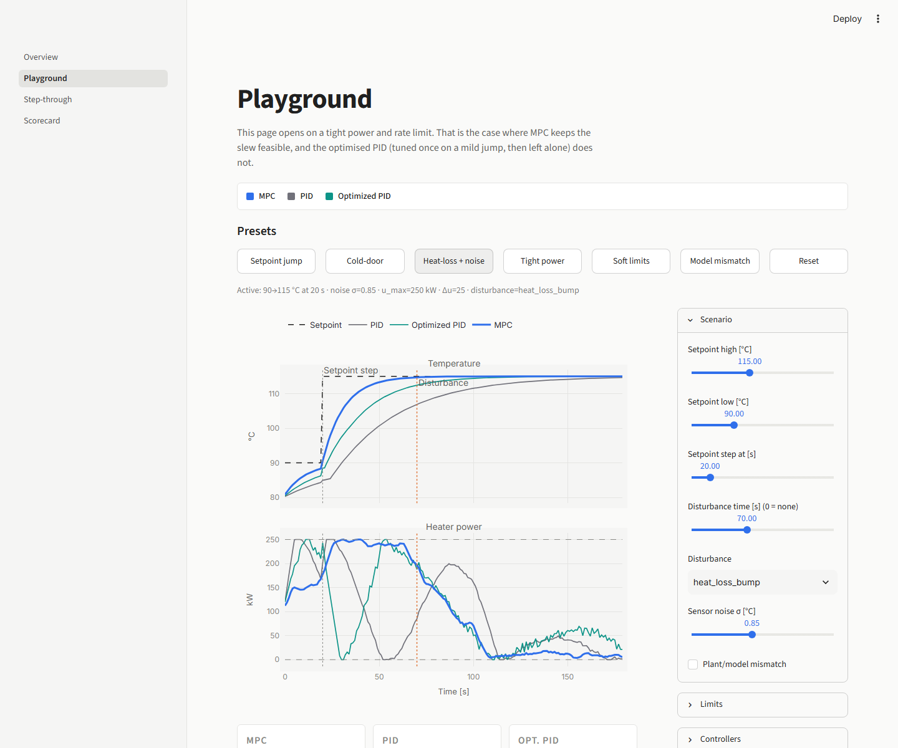 | 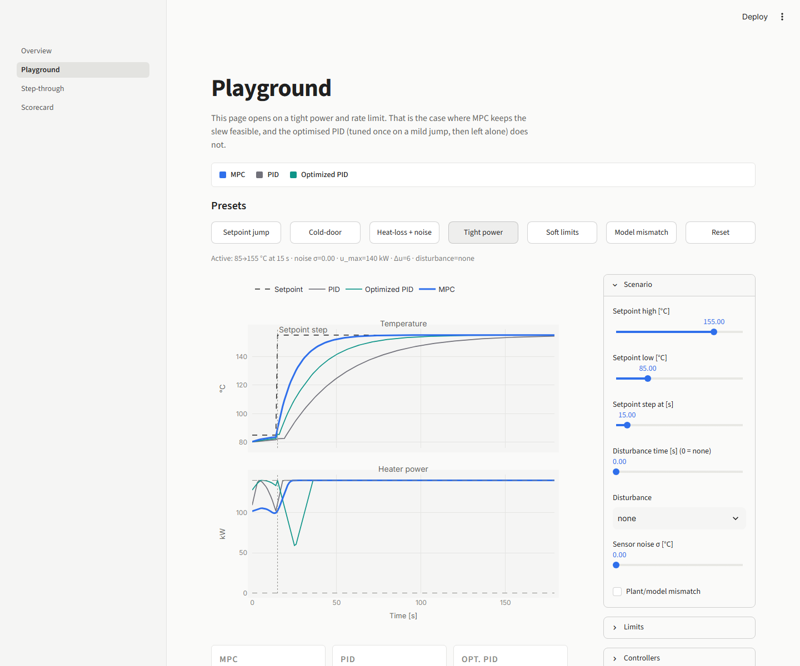 |

| Soft limits + different knobs | Model mismatch |
| :---: | :---: |
| 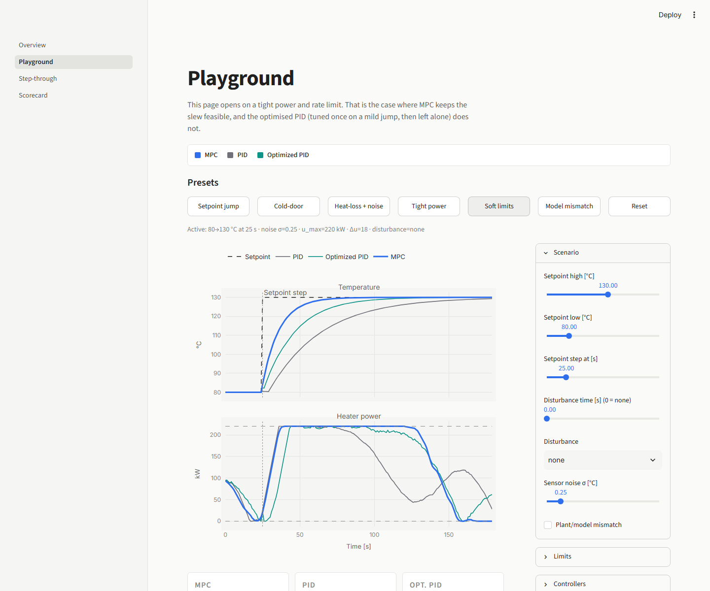 | 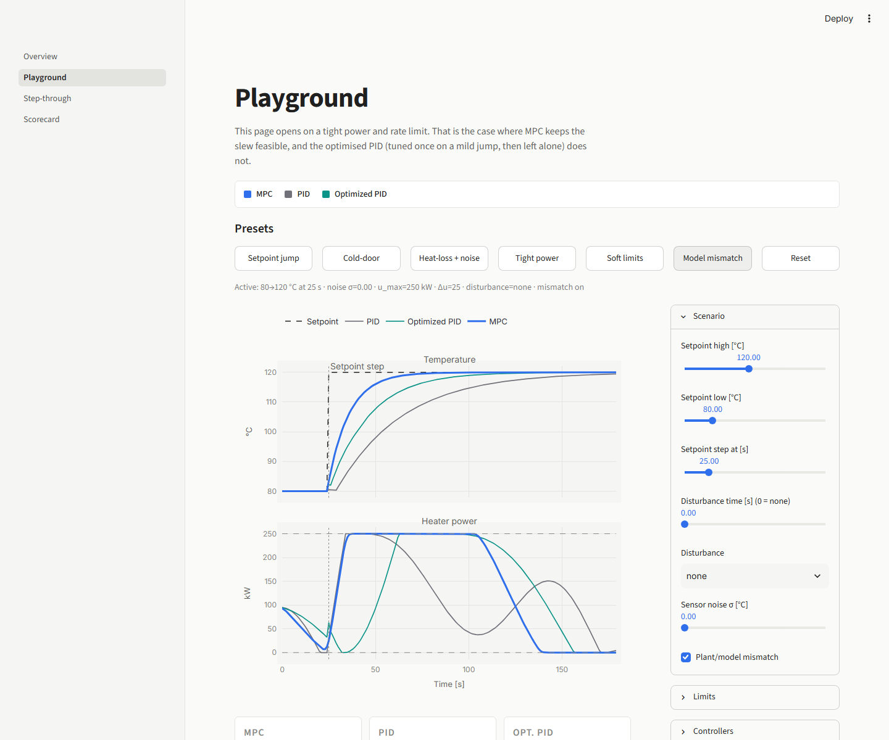 |

### Step-through

Walk one MPC horizon at a time.

<p align="center">
  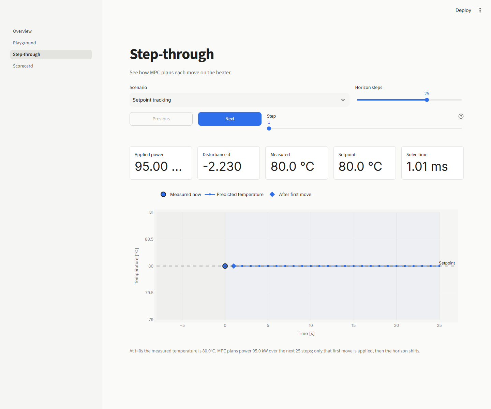
</p>

### Scorecard

Same scenarios as the batch runs: limit hits, settling, overshoot (including model mismatch).

<p align="center">
  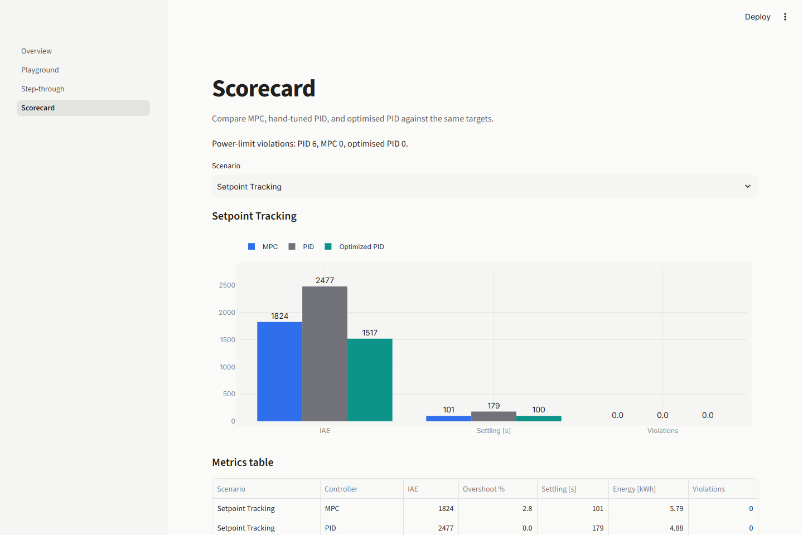
</p>

## Showcase video

The cut focuses on power limits: plain PID breaks the slew; MPC stays inside the limits by planning ahead; optimised PID keeps the gains from the mild setpoint jump and is not retuned on the tight-limit case.

<p align="center">
  <a href="https://raw.githubusercontent.com/Vinayak-RZ/model-predictive-control/main/video/out/mpc-vs-pid.mp4">
    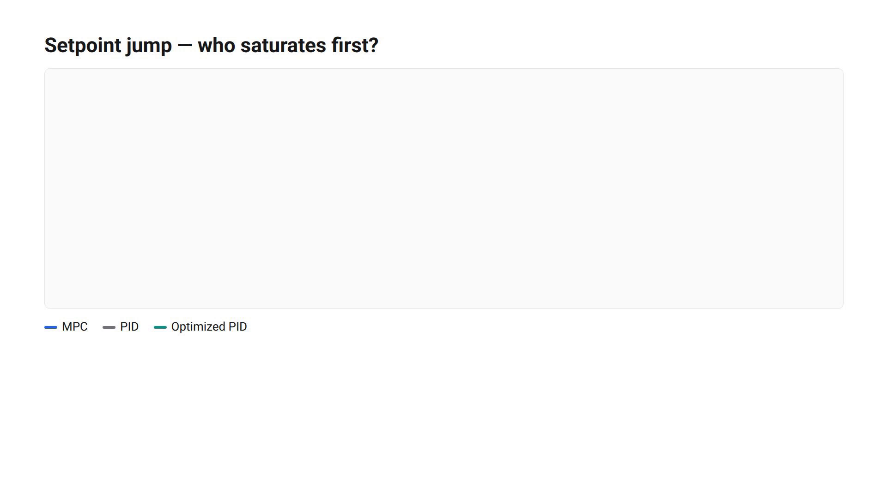
  </a>
</p>

<p align="center">
  <video src="https://raw.githubusercontent.com/Vinayak-RZ/model-predictive-control/main/video/out/mpc-vs-pid.mp4" controls width="720" poster="docs/video-poster.png">
    Your browser does not support inline video. <a href="https://raw.githubusercontent.com/Vinayak-RZ/model-predictive-control/main/video/out/mpc-vs-pid.mp4">Download the MP4</a>.
  </video>
</p>

<p align="center">
  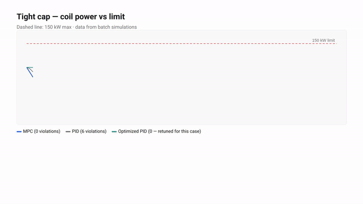
</p>

**Repo copy:** [`video/out/mpc-vs-pid.mp4`](video/out/mpc-vs-pid.mp4) · **Duration:** 82 s · **Size:** ~1.8 MB · **Source:** [`video/index.html`](video/index.html) + [`video/data/`](video/data/) from `python3 scripts/export_video_data.py`.

## Proof (batch metrics)

Figures below match the Streamlit scorecard used for the presentation deck (`presentation.py`).

| Scenario | Metric | MPC | PID | Optimised PID |
| --- | --- | --- | --- | --- |
| Setpoint tracking | Settling [s] | **73** | 179 | 99 |
| Setpoint tracking | IAE | **1044** | 2477 | 1466 |
| Disturbance rejection | Settling [s] | **46** | 103 | 60 |
| Power limits | Limit hits | **0** | 6 | 0 |
| Power limits | IAE | **8727** | 9153 | 9033 |
| Model mismatch | Settling [s] | **83** | 167 | 109 |

Simulation plots:

| Setpoint | Disturbance | Power limits |
| :---: | :---: | :---: |
|  |  |  |

**Fair comparison (UI):** optimised PID gains are tuned once on the mild setpoint jump (`baseline_optimized_pid` in `playground.py`), then frozen across presets and scorecard scenarios. You do not get a free retune for every operating condition. MPC uses the same planner throughout. Batch scripts may still retune per scenario for report tables. Heater power is clipped to `[u_min, u_max]` every step.

## How it works

```text
  y_meas ──► offset-free MPC (SciPy on ARX + d_hat)
                    │
                    ▼ u [kW]
              CasADi heater plant ──► temperature [°C]
                    ▲
         PID + optimised PID (same plant, same metrics)
```

Plain story: [`docs/EXPLAINER.md`](docs/EXPLAINER.md) · Maths / EE: [`docs/THEORY.md`](docs/THEORY.md) · Engineering notes: [`HOW-IT-WORKS.md`](HOW-IT-WORKS.md) · Course write-up: [`report/report.pdf`](report/report.pdf) · source [`report/main.tex`](report/main.tex) · notes [`report/README.md`](report/README.md)

Educational use. Licences: [`CREDITS.md`](CREDITS.md).
