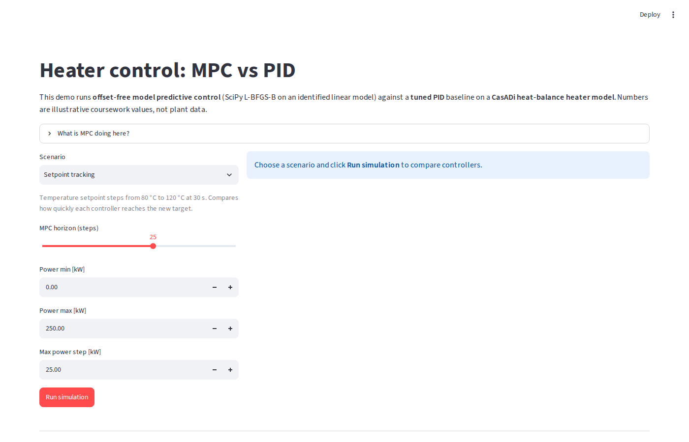
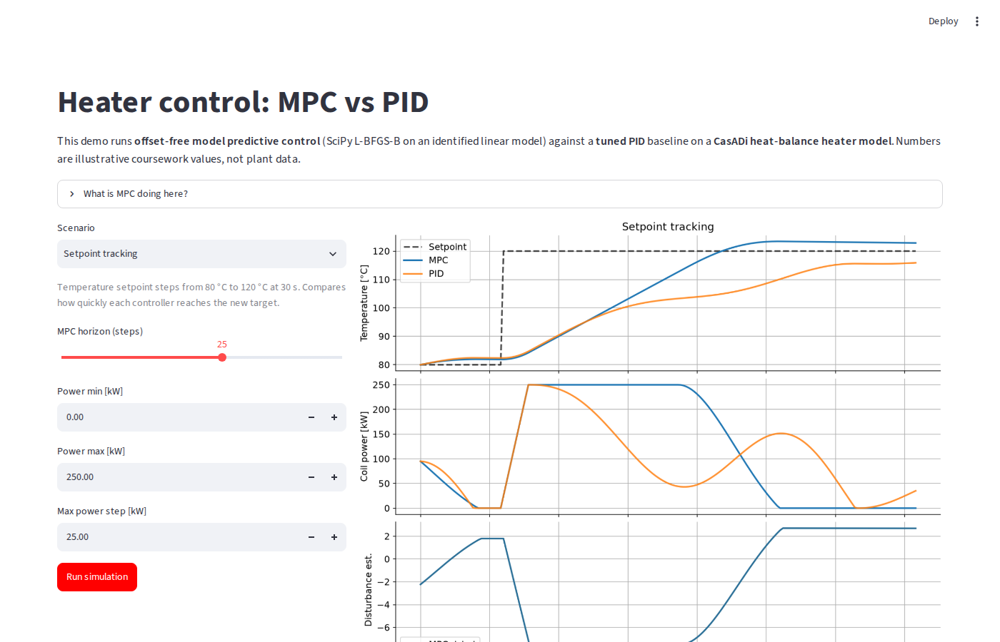
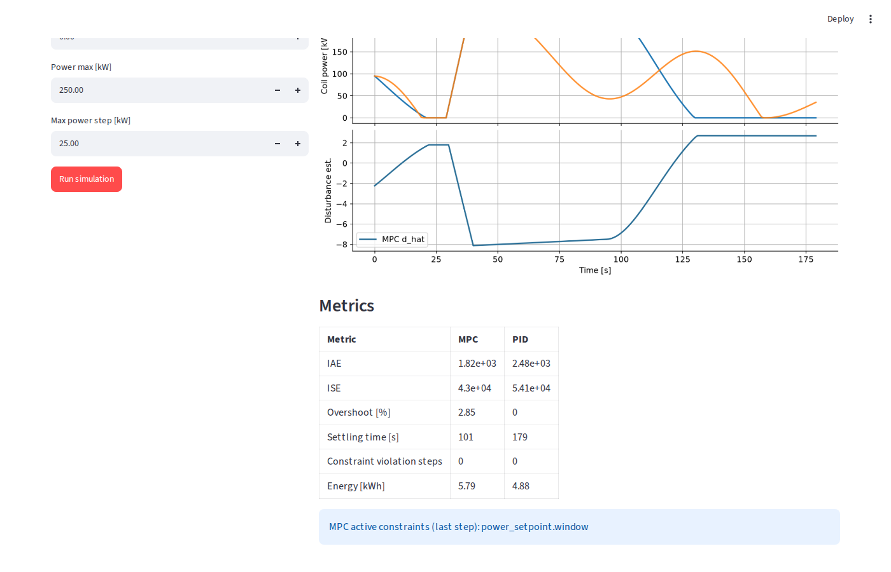

<p align="center">
  
</p>

<h1 align="center">
  
</h1>

<p align="center">
  <strong>Hands-on offset-free MPC vs PID on a heat-balance heater model.</strong>
</p>

<p align="center">
  <a href="#quick-start"><b>Quick start</b></a> ·
  <a href="#try-these-prompts"><b>Try these prompts</b></a> ·
  <a href="HOW-IT-WORKS.md"><b>How it works</b></a> ·
  <a href="report/report.md"><b>Report</b></a> ·
  <a href="CREDITS.md"><b>Credits</b></a>
</p>

Turn your **Python environment** into a **closed-loop control comparison lab**. **3**
scenarios, **1** Streamlit UI, batch plots under `results/`.

Describe a scenario in plain language (setpoint step, heat-loss bump, or tight
power limits). **MPC Heater Lab** runs the **CasADi heater plant**, solves
**offset-free MPC** with SciPy each second, benchmarks a **tuned PID**, and
writes **IAE / ISE / settling / violations / energy** you can drop into a report.

> **MPC Heater Lab is coursework simulation you can run today.** It is not a
> field PLC program or a vendor induction line pack.
> Primary interface: `streamlit run app.py` (batch: `python examples/run_simulations.py`).
> Invariant: **MPC uses SciPy for the QP; CasADi steps the plant only.**

## Proof

Run the batch harness to regenerate figures and `results/metrics_summary.json`:

```text
$ pip install -r requirements.txt && pip install -e ".[dev]"
$ pytest -q
$ python examples/run_simulations.py
Wrote results/setpoint_tracking.png
Wrote results/disturbance_rejection.png
Wrote results/power_constraints.png
Done. Figures in results
```

That command proves the three scenario loops, metrics ledger, and PNG exports match the tables below.

### Streamlit workspace

Scenario controls and MPC horizon slider:



*Pick a scenario, power limits, and horizon, then run MPC and PID on the same plant.*

MPC vs PID traces after a run:



*Temperature, coil power, and MPC disturbance estimate on one screen.*

Metrics table in the app mirrors the batch ledger:



## What it achieves (honest)

Numbers come from [`results/metrics_summary.json`](results/metrics_summary.json) and the per-scenario [`results/*_metrics.md`](results/) files. MPC wins on tracking and rejection; PID can look better on raw IAE only when it breaks slew limits.

| Scenario | Metric | MPC | PID | Highlight |
| --- | --- | --- | --- | --- |
| Setpoint tracking | IAE | 1824 | 2477 | **MPC −26%** integrated error |
| Setpoint tracking | Settling time [s] | **101** | 179 | MPC enters ±3% band **78 s sooner** |
| Disturbance rejection | IAE | **955** | 1090 | MPC **−12%** after heat-loss step |
| Disturbance rejection | Settling time [s] | **62** | 103 | MPC recovers **41 s faster** |
| Power limits | Constraint violation steps | **0** | **6** | PID breaks 8 kW/s slew **6 times** |
| Power limits | IAE | 9480 | 9153 | PID lower only with violations (MPC stays feasible) |

Simulation plots (same runs as the ledger):

| Setpoint tracking | Disturbance rejection | Power limits |
| --- | --- | --- |
|  |  |  |

## Try these prompts

Open this repo in **Cursor**, **VS Code**, or any Python-aware assistant and paste:

```text
Explain how offset-free MPC updates d_hat in this repo and where PID differs in sim/pid.py.
```

```text
Add a fourth scenario with a slower setpoint ramp and regenerate results/ plots and metrics_summary.json.
```

## Quick start

You need **Python 3.12+** and a virtualenv (recommended).

```bash
python3 -m venv .venv && source .venv/bin/activate
pip install -r requirements.txt
pip install -e ".[dev]"
pytest
python examples/run_simulations.py
streamlit run app.py
```

Course write-up with the same figures: [`report/report.md`](report/report.md).

## How it works

```text
  y_meas ──► offset-free MPC (SciPy L-BFGS-B on ARX + d_hat)
                    │
                    ▼ u [kW]
              CasADi heater plant ──► temperature [°C]
                    ▲
              PID baseline (same plant, same metrics)
```

- **Offset-free horizon MPC.** Rolls a identified linear model, sums squared temperature error over `N` steps, and applies box plus slew limits on coil power. Limit: one held power move per solve (not full move blocking). [Pannocchia & Rawlings, 2003](https://doi.org/10.1002/aic.690490508).
- **CasADi heat-balance plant.** Integrates `m c_p dT/dt = η P − U (T − T_amb)` with explicit Euler. Limit: linear MPC predicts a nonlinear plant; mismatch is partly handled by `d_hat`.
- **Scenario harness.** Three scripted setpoint and disturbance cases with shared metrics (IAE, ISE, overshoot, settling, violations, energy). Limit: illustrative coefficients, not plant identification data.
- **Streamlit teaching UI.** Re-runs any scenario with editable limits and horizon. Limit: single-user local tool, not a deployed HMI.

Deeper solver and plant notes: [`HOW-IT-WORKS.md`](HOW-IT-WORKS.md).

## Go deeper

| Doc | Contents |
| --- | --- |
| [`HOW-IT-WORKS.md`](HOW-IT-WORKS.md) | Cost, constraints, horizons, CasADi twin |
| [`report/report.md`](report/report.md) | Course report and interpretation |
| [`CREDITS.md`](CREDITS.md) | Licences (CasADi LGPL, SciPy, Streamlit, etc.) |
| [`examples/run_mpc_demo.py`](examples/run_mpc_demo.py) | Minimal MPC loop plus one plant step |

Educational use. Dependency licences in `CREDITS.md`.
