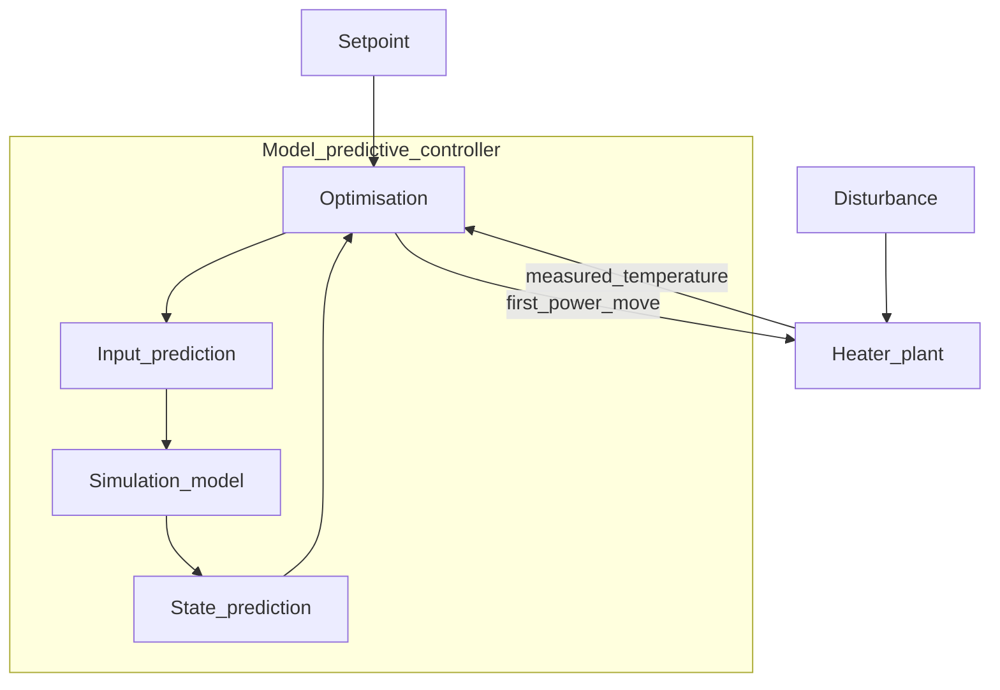
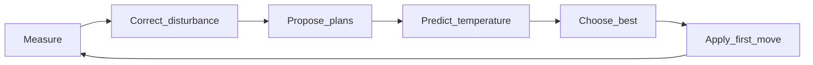
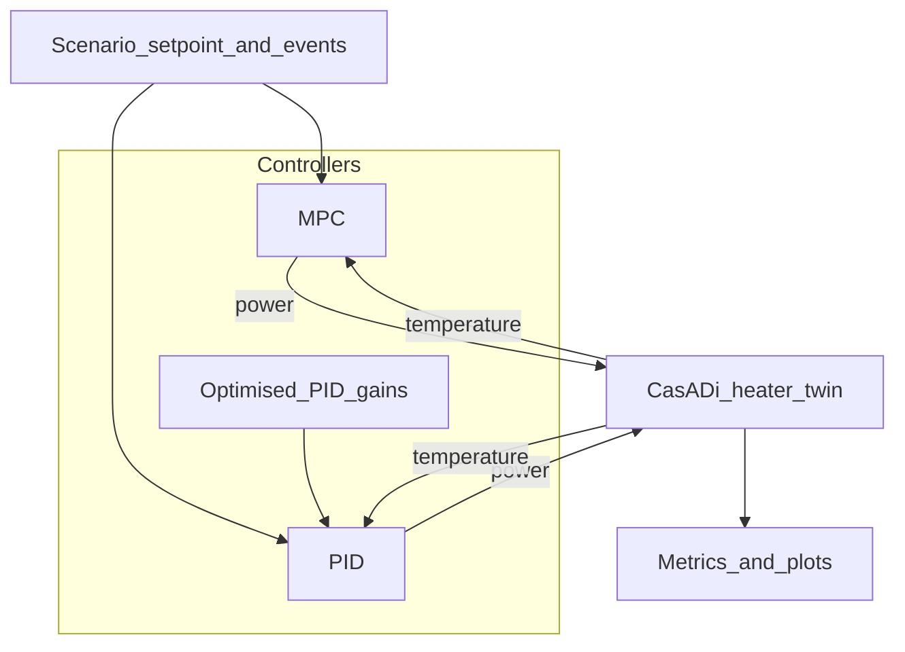

# What this project is doing (plain explainer)

> **Companion:** maths and industrial-control detail → [THEORY.md](THEORY.md)  
> Short engineering reference → [HOW-IT-WORKS.md](../HOW-IT-WORKS.md) · Results narrative → [report/report.md](../report/report.md)

All numbers in this lab are **illustrative coursework values**, not a real customer plant.

---

## In one sentence

Every second, the controller looks a short way into the future with a model of the heater, tries candidate coil-power plans that respect power limits, picks the plan whose predicted temperature stays closest to the target, applies **only the first step** of that plan, then measures the real temperature and does it again.

## The picture to hold

You are driving toward a destination on a winding road (the temperature you want). A normal thermostat only reacts when you are already too hot or too cold. This controller is like glancing at a map for the next few bends: it imagines “if I set the heater power like *this*, where will temperature be in the next half-minute?”, refuses plans that would demand illegal power, then turns the wheel once and looks again.

That look-ahead loop is what people call **model predictive control** (MPC).

---

## The four boxes on the infographic

The repo banner diagram is the same story in engineering boxes. Walk them in the order the controller thinks.

### 1. Optimisation (the decision box)

**What it does:** scores many candidate power plans and picks the best one that still obeys the rules.

**Rules here:** coil power must stay inside a allowed window, and it cannot jump by more than a maximum step from the current power. The “score” is how far the *predicted* temperature would sit from the temperature you asked for (the **setpoint**), over a short future window called the **horizon**.

**In this project:** SciPy’s `L-BFGS-B` optimiser does that search inside [`src/mpc_core/mpc.py`](../src/mpc_core/mpc.py). It does **not** talk to the real heater directly — it only talks to the simulation model below.

### 2. Simulation model (the imagination)

**What it does:** answers “if I apply this power sequence, what temperature trajectory do I get?”

**Important split in this lab:**

| Piece | Role | Code |
| --- | --- | --- |
| **MPC simulation model** | Fast linear guess used *inside* the optimiser | Identified model in `identified.py`, rolled forward in `mpc.py` |
| **Plant / heater twin** | Stand-in for the *real* heater in closed-loop demos | Nonlinear heat-balance step in `twin/ibh.py` |

The optimiser plans with the linear model. The demo then applies power to the nonlinear twin (plus optional noise and disturbances). That mismatch is intentional — industrial controllers rarely get a perfect model.

### 3. Input prediction (planned power over the horizon)

**What it is:** a sequence of future coil-power values the optimiser is considering, from “now” out to the end of the horizon.

By default this lab uses a simple plan shape: a small number of free power moves (often **one**), then hold the last value for the rest of the horizon. Only the **first** planned power is sent to the plant. The rest of the sequence is discarded and recomputed next sample. That discard-and-replan habit is the **receding horizon**.

### 4. State prediction (planned temperature over the horizon)

**What it is:** the temperature trajectory the simulation model expects if that input plan were followed.

The optimiser keeps adjusting the input plan until the state prediction hugs the setpoint as well as the constraints allow. Those prediction charts are what the Streamlit **Step-through** page shows for one MPC tick.

---

## The loop that never stops

One control tick, in order:

1. **Measure** the current temperature (and know the current power).
2. **Update a disturbance guess** so slow model error and load changes do not leave a permanent offset (this lab’s “offset-free” piece).
3. **Propose** candidate power plans that respect window and rate limits.
4. **Predict** temperature for each plan with the linear model.
5. **Choose** the plan with the best score.
6. **Apply** only the first power of that plan to the plant.
7. Wait one sample time, then go back to step 1.

---

## What this repository actually wires together

- **Closed-loop runner:** [`src/mpc_core/sim/simulate.py`](../src/mpc_core/sim/simulate.py) — same plant, noise options, and limits for fair comparison.
- **Interactive lab:** `streamlit run app.py` — Playground, Step-through, Scorecard.
- **Batch figures:** `examples/run_simulations.py` → `results/`.

You can run three controller stories on the same heater story:

| Controller | Behaviour in one line |
| --- | --- |
| **MPC** | Plans ahead with a model; hard power limits inside the optimiser |
| **PID** | Reacts to the temperature error now / over time / how fast it is changing; no preview |
| **Optimised PID** | Still a PID online, but its three gains were chosen offline by an optimiser on the same scenario |

---

## PID, without the mystique

A **PID** controller does not invent future plans. Each sample it looks at the **error** (setpoint minus measured temperature) and builds a power command from three pieces:

- **P (proportional):** how far off you are *right now* — big gap, bigger nudge.
- **I (integral):** how long you have been a bit off — closes the last stubborn gap.
- **D (derivative):** how fast the error is changing — brakes before you overshoot.

In this lab, [`src/mpc_core/sim/pid.py`](../src/mpc_core/sim/pid.py) also **clips** power to limits and uses **anti-windup** so the integral does not keep winding up while the heater is already at max power.

### Optimised PID

Hand-picked gains are one baseline. **Optimised PID** keeps the same online law, but [`src/mpc_core/sim/pid_tune.py`](../src/mpc_core/sim/pid_tune.py) searches for gains that minimise a cost: mainly **IAE** (integrated absolute error) plus a penalty if the run violates power or rate limits.

So “optimised PID” means *offline tuning by optimisation*, not a second predictive controller. It is a strong, honest baseline: it can beat MPC on raw error when retuned for that exact scenario, but it still has **no horizon preview**, and you pay that tuning cost again when the regime changes.

---

## Explain it to a friend

Use this script almost verbatim:

> We built a small induction-heater lab in software. The “real” heater is a heat-balance twin: power in, heat loss out, temperature moves.  
> Against that twin we run three controllers. A PID turns the power up or down from the temperature error. An optimised PID is the same idea with gains found by a search.  
> MPC is different: every second it uses a simple model to predict temperature under candidate power plans, refuses illegal plans, picks the best one, applies only the first power setting, then remeasures and replans.  
> The point of the coursework is to see when preview and hard constraints help, and when a well-tuned PID still competes.

---

## Where the picture breaks

- The **map** (linear model) is not the **road** (nonlinear twin). Bad models shrink MPC’s advantage — the lab has a model-mismatch scenario for that.
- Default MPC plans are deliberately simple (few free moves, then hold). Full industrial MPC can free every step and add move penalties; this coursework keeps the decision small.
- We constrain **power**, not temperature. A plant that must never exceed a metal temperature limit would need extra constraint machinery.
- Parameters and gains are coursework illustrations. Do not treat plots as a site acceptance test.

---

## Words introduced here

| Word | Meaning in this project |
| --- | --- |
| **Setpoint** | The temperature you want |
| **Horizon** | How far into the future the MPC predicts and scores |
| **Receding horizon** | Replan every sample; apply only the first move |
| **Plant** | The process being controlled (here: heater twin) |
| **Simulation model** | The predictor inside the MPC optimiser |
| **Input prediction** | Planned future power sequence |
| **State prediction** | Predicted future temperature sequence |
| **Constraint** | Hard rule the optimiser must not break (power window, max step) |
| **Offset-free** | Disturbance correction so steady error does not stick around |
| **PID** | Proportional–integral–derivative error feedback |
| **IAE** | Integrated absolute tracking error (smaller is tighter tracking) |

---

## Where to go next

- **Maths, heat balance, cost function, discrete PID, metrics:** [THEORY.md](THEORY.md)
- **Knob list and solver notes:** [HOW-IT-WORKS.md](../HOW-IT-WORKS.md)
- **Scenario tables and figures:** [report/report.md](../report/report.md)
