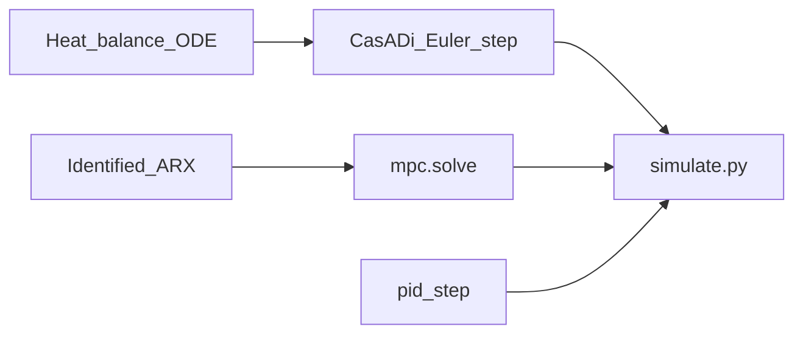
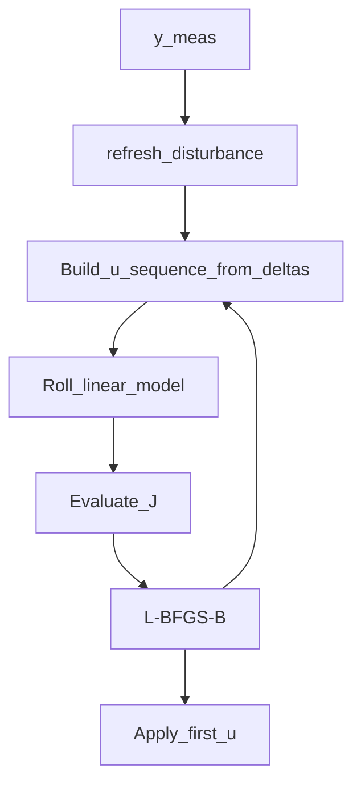

# Industrial control theory for this lab

> **Start here if you want equations.** Plain story with almost no maths → [EXPLAINER.md](EXPLAINER.md)  
> Knob list → [HOW-IT-WORKS.md](../HOW-IT-WORKS.md) · Scenario tables → [report/report.md](../report/report.md)

British spelling. Symbols match what the code implements. Numeric examples are **illustrative coursework values**, not plant data.

---

## Part 0 — Why this document exists

### The control problem in one paragraph

An induction heater puts electrical power into a workpiece; temperature rises; heat also leaks to the surroundings. The industrial job is to **track a temperature setpoint** while respecting **actuator limits** (coil power window and how fast power may slew). This coursework compares three ways to choose that power each sample: offset-free **MPC**, hand-tuned **PID**, and **optimised PID** (same PID law, gains found offline).

### Why go into the maths

Industrial control design is not “pick a controller name.” You need:

1. A **plant model** you can write and simulate — otherwise you cannot predict or tune safely.
2. A **decision problem** with an explicit cost and hard constraints — otherwise “optimal” is a slogan.
3. **Metrics** that match the engineering goal — tracking error, settling, energy, constraint violations.

Without those, you cannot explain *what* was optimised, *why* MPC and PID differ on the same heater, or defend the plots in the report. The sections below climb from the heat balance into the discrete controllers this repository actually runs.

If you only need the kitchen-table story, stop at [EXPLAINER.md](EXPLAINER.md).

### Symbol ↔ code map

| Idea | Symbol (this doc) | Code |
| --- | --- | --- |
| Temperature (controlled variable) | \(T\) or \(y\) | Plant state / measured \(y\) |
| Coil power (manipulated variable) | \(P\) or \(u\) | Setpoint id `power_setpoint` |
| Setpoint | \(r\) or \(y_{\mathrm{ref}}\) | Scenario reference trace |
| Sample time | \(\Delta t\) | `dt_s` |
| Linear prediction model | \(a, b\) | `IdentifiedLinearModel` |
| Integrating disturbance | \(\hat{d}\) | `MpcState.d_hat` |
| Horizon length | \(N\) | `horizon_steps` |
| PID gains | \(K_p, K_i, K_d\) | `PIDGains` |

---

## Part 1 — Plant (thermal / EE framing)

### Why a heat balance

Electrical power delivered by the coil does not all appear as workpiece temperature rise. A first engineering model lumps the workpiece as one thermal mass and writes energy conservation: power that stays in the metal minus power that leaves to ambient equals the rate of change of stored thermal energy.

### Continuous model

\[
m\, c_p\, \frac{\mathrm{d}T}{\mathrm{d}t}
=
\eta\, P
-
U\,(T - T_{\mathrm{amb}})
\]

| Symbol | Meaning |
| --- | --- |
| \(m\) | Effective thermal mass (kg) |
| \(c_p\) | Specific heat (J/(kg·K)) |
| \(T\) | Lumped workpiece temperature (°C) |
| \(\eta\) | Fraction of coil power that becomes useful heat (dimensionless) |
| \(P\) | Coil electrical power (W in the twin; demos also speak in kW) |
| \(U\) | Effective heat-loss coefficient (W/K) |
| \(T_{\mathrm{amb}}\) | Ambient temperature (°C) |

This is a **first-order nonlinear** plant in \(T\) (the loss term depends on \(T\)). Geometry (coil turns, frequency, diameter) is *not* invented in this module; those belong to a fuller EM model. Here the twin is the pack-bound heat balance in [`src/mpc_core/twin/ibh.py`](../src/mpc_core/twin/ibh.py).

### Discrete twin (explicit Euler)

Controllers run at a fixed sample time \(\Delta t\). The CasADi step is explicit Euler:

\[
T_{k+1}
=
T_k
+
\Delta t\cdot
\frac{\eta\, P_k - U\,(T_k - T_{\mathrm{amb}})}{m\, c_p}
\]

That is the “plant” inside closed-loop simulations. Disturbances in the lab (cold door, \(U\) bump, sensor noise, parameter mismatch) change what the twin experiences relative to the controller’s beliefs.

---

## Part 2 — Prediction model inside the MPC

### Why not optimise on the nonlinear twin every tick?

You *could* embed the nonlinear ODE in a heavy NLP. This coursework uses a **fast identified linear discrete model** so each second’s solve stays small (SciPy `L-BFGS-B`, soft time limit). The twin remains the truth for evaluation; the linear model is the optimiser’s imagination.

### SISO ARX form

\[
y_{k+1} = a\, y_k + b\, u_k + \hat{d}
\]

- \(y\): temperature used by the MPC (°C)
- \(u\): coil power command (same units as in the identified experiment)
- \(a, b\): fit coefficients from an identification experiment (`IdentifiedLinearModel`)
- \(\hat{d}\): integrating disturbance (next section) — not part of the raw fit record

The module **never invents** \(a, b\); it refuses \(b = 0\) and bad sample metadata.

**Steady-state gain** (how much \(\Delta y\) for a held \(\Delta u\) when \(\hat{d}\) is fixed):

\[
K_{\mathrm{ss}} = \frac{b}{1 - a}
\quad (a \neq 1)
\]

Illustrative unit-test ARX only: \(a = 0.9\), \(b = 0.05\) ⇒ \(K_{\mathrm{ss}} = 0.5\). Demo configs use their own identified card — see the report for scenario setup.

### Rolling a plan (state prediction)

Given \(y_0 = y_{\mathrm{meas}}\), \(\hat{d}\), and a candidate sequence \(u_0,\ldots,u_{N-1}\):

\[
y_{i+1} = a\, y_i + b\, u_i + \hat{d},
\quad i = 0,\ldots,N-1
\]

That sequence \(\{y_i\}\) is the **state prediction**. The sequence \(\{u_i\}\) is the **input prediction**.

---

## Part 3 — The optimisation problem (MPC)

### Receding-horizon idea, formally

At each sample:

1. Form a finite-horizon decision problem.
2. Solve for a planned input sequence.
3. Apply **only the first** input.
4. Shift time, remeasure, resolve.

### Decision variables (move blocking)

Instead of freeing every \(u_i\), the code optimises **increments** \(\Delta u_0,\ldots,\Delta u_{n_u-1}\) (`n_u_moves`, default **1**), integrates them from the current \(u_0\), clips to the power window, and **holds the last free value** for the remainder of the horizon (`_deltas_to_sequence` in [`mpc.py`](../src/mpc_core/mpc.py)).

Rate limits appear as box bounds on each \(\Delta u\):

\[
|\Delta u_j| \le \Delta u_{\max}
\]

The first applied move is also clipped into the one-step feasible set

\[
u^\star \in
\bigl[\max(u_{\min},\, u_0 - \Delta u_{\max}),\;
\min(u_{\max},\, u_0 + \Delta u_{\max})\bigr].
\]

### Cost (what “best” means here)

With predicted temperatures \(y_i\) and reference \(y_{\mathrm{ref}}\):

\[
J
=
w
\sum_{i=0}^{N-1}
w_i\, (y_i - y_{\mathrm{ref}})^2
\]

- \(w\): `tracking_weight` (default 1)
- \(w_i = 1\) early in the horizon; from about the last third of the horizon, \(w_i = 2.5\) (**terminal emphasis**) so late errors matter more
- There is **no move-suppression term** in this coursework controller (documented on purpose so nothing is invented)

Constraints are the power window and max step above — treated as bounds in the solver, not soft penalties inside \(J\).

### Solver

- Library: SciPy `minimize`, method **`L-BFGS-B`**
- Soft wall clock: objective raises `MpcTimedOut` if `time_limit_s` is exceeded
- Return: first-move proposal, predicted \(y\) sequence, active constraint tags, updated `MpcState`

### Offset-free disturbance (why \(\hat{d}\))

A constant model bias or slow load change would leave a steady tracking offset if the predictor never corrected. This lab uses an **integrating disturbance** in the spirit of Pannocchia & Rawlings (2003). Each solve refreshes \(\hat{d}\) from the one-step innovation (`refresh_disturbance`):

- **First run** (no history): initialise as if at steady state  
  \(\hat{d}_0 = (1-a)\, y_{\mathrm{meas}} - b\, u_{\mathrm{current}}\)
- **Later runs:**  
  \(y_{\mathrm{pred}} = a\, y_{\mathrm{last}} + b\, u_{\mathrm{last}} + \hat{d}\),  
  then \(\hat{d} \leftarrow \hat{d} + (y_{\mathrm{meas}} - y_{\mathrm{pred}})\)  
  (full innovation correction; no separate observer gain)

That is the “offset-free” label in the README: the controller absorbs persistent prediction error into \(\hat{d}\) so the plan can cancel it.

---

## Part 4 — PID and optimised PID

### Discrete PID as implemented

Error at sample \(k\):

\[
e_k = y_{\mathrm{ref}} - y_k
\]

[`pid_step`](../src/mpc_core/sim/pid.py) builds an incremental-style command from proportional, integral, and derivative pieces (with previous command \(u_{\mathrm{prev}}\)):

\[
I_k = I_{k-1} + e_k\,\Delta t,
\quad
D_k = \frac{e_k - e_{k-1}}{\Delta t}\ (\Delta t > 0),
\]

\[
u_{\mathrm{raw}}
=
u_{\mathrm{prev}}
+ K_p\, e_k
+ K_i\, I_k
+ K_d\, D_k
\]

Then:

1. Clip to \([u_{\min}, u_{\max}]\).
2. If clipping happened and \(K_i \neq 0\), **back-calculate** \(I_k\) so the integral does not keep winding (**anti-windup**).
3. Optionally enforce a rate limit \(|u - u_{\mathrm{prev}}| \le \Delta u_{\max}\).

No prediction model appears. Constraints are handled by clamping (and optional rate limiting), not by an inner optimiser at runtime.

### Optimised PID (offline)

[`tune_pid_gains`](../src/mpc_core/sim/pid_tune.py) searches \(x = (K_p, K_i, K_d)\) with the same SciPy **`L-BFGS-B`** family, but the objective is **not** the MPC horizon cost. For each candidate gain vector it runs a full closed-loop scenario and scores:

\[
J_{\mathrm{tune}}
=
\mathrm{IAE}
+
\lambda\cdot(\text{constraint violation steps})
\]

Default \(\lambda = 250\). Gain bounds in code: \(K_p \in [0.05, 12]\), \(K_i \in [0, 0.35]\), \(K_d \in [0, 8]\`.

**Fairness:** MPC, PID, and tuned PID share the same plant twin path, noise seed options, and limit objects via `simulate.run_closed_loop`. Optimised PID is therefore a strong baseline: scenario-specific offline search, still no preview online.

---

## Part 5 — Metrics and what the scenarios test

### Definitions (as coded in `metrics.py`)

Let \(e(t) = y_{\mathrm{ref}}(t) - y(t)\), discrete with steps \(\Delta t_k\).

| Metric | Definition (lab) | What it rewards |
| --- | --- | --- |
| **IAE** | \(\sum \|e_k\|\,\Delta t_k\) | Less absolute area off target |
| **ISE** | \(\sum e_k^2\,\Delta t_k\) | Penalises large errors harder |
| **Overshoot %** | Peak excursion vs late reference segment | Less ringing past the target |
| **Settling time** | Time after which \(y\) stays in a ±3% band of the late reference (lab heuristic) | Faster “close enough” |
| **Violation steps** | Samples outside power window or exceeding \(\Delta u_{\max}\) | Feasible actuation |
| **Energy** | \(\sum u_k\,\Delta t_k / 3600\) (kWh with \(u\) in kW) | Less energy for the same job |

### Coursework scenarios (intent)

| Scenario | Engineering question |
| --- | --- |
| Setpoint tracking | Who reaches the new temperature band cleanly? |
| Disturbance rejection | Who recovers when heat loss jumps? (\(U\) bump; \(\hat{d}\) helps MPC) |
| Power / rate limits | Who stays feasible when the target is aggressive? |
| Model mismatch | How much does MPC degrade when the twin ≠ the linear model? |

Numbers and figures live in [report/report.md](../report/report.md) — this document does not duplicate the tables.

### EE takeaways you should be able to defend

1. **MPC** encodes preview + constraints as an explicit optimisation; compute cost is a small NLP each sample.
2. **PID** encodes present/past/trend of error; compute cost is negligible; constraint handling is outer clamping unless you add structure.
3. **Optimised PID** shows that “PID lost” is often “PID not retuned”; offline search can win on IAE for *that* scenario without becoming predictive.
4. **Offset-free** linear MPC still depends on a usable model; mismatch shrinks the gap to feedback-only methods.

---

## Where the picture breaks (theory level)

- Linear ARX + \(\hat{d}\) ≠ nonlinear heat balance; local validity only.
- Default \(n_u = 1\) is move-blocked simplicity, not full multi-move industrial MPC.
- No state (temperature) inequality constraints — only input window/rate.
- Identification, model cards, and thresholds exist for gating; production would add move weights, MIMO, and harder validation.
- Illustrative parameters: do not cite coursework numbers as site data.

---

## Words and symbols introduced

| Symbol / term | Meaning |
| --- | --- |
| \(m, c_p, \eta, U, T_{\mathrm{amb}}\) | Heat-balance parameters |
| \(a, b\) | Discrete linear prediction coefficients |
| \(\hat{d}\) | Integrating disturbance for offset-free control |
| \(N\), horizon | Prediction length in samples |
| \(J\) | MPC tracking cost (weighted SSE) |
| \(\Delta u_{\max}\) | Maximum power step per sample |
| \(K_p, K_i, K_d\) | PID gains |
| IAE / ISE | Integrated absolute / squared error |
| Receding horizon | Replan every sample; apply first move only |
| Move blocking | Few free moves, then hold |

---

## References (verified in-repo)

1. Pannocchia, G. and Rawlings, J. B. (2003). Disturbance models for offset-free model-predictive control. *AIChE Journal*. (Cited for the offset-free idea; implementation is the innovation update in `mpc.py`.)
2. Implementation notes: [HOW-IT-WORKS.md](../HOW-IT-WORKS.md)
3. Experimental narrative: [report/report.md](../report/report.md)
4. Plain explainer: [EXPLAINER.md](EXPLAINER.md)
