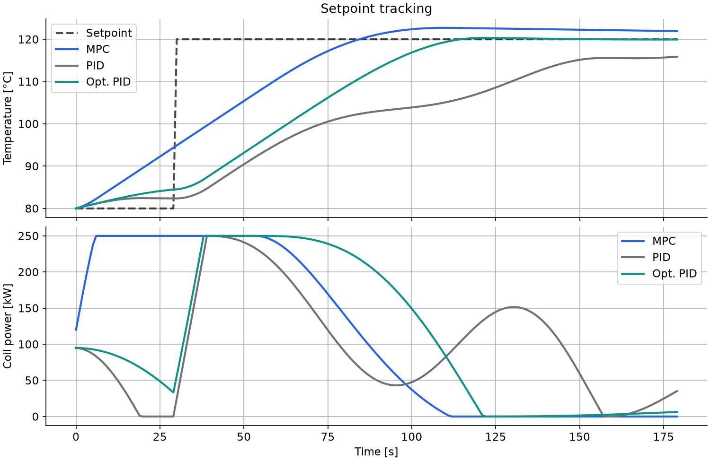
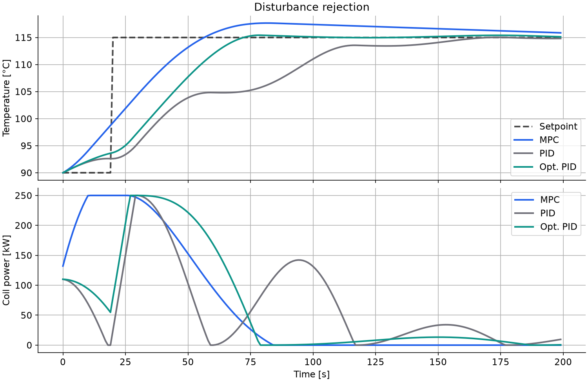
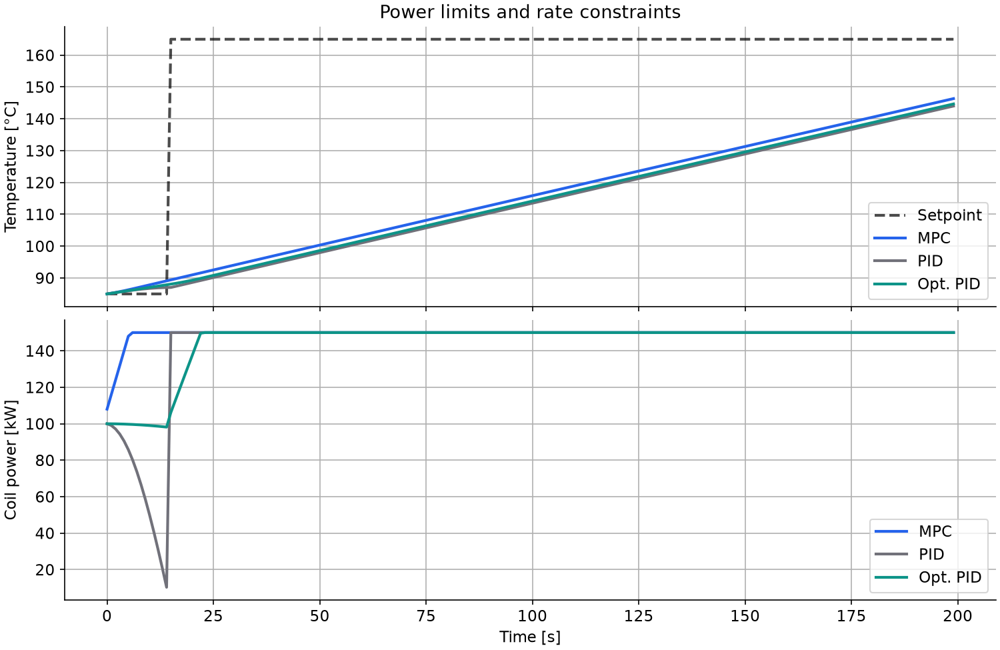

# Model predictive control for induction heating

**Author:** Vinayak · Industrial Control coursework · IIT Roorkee (Electrical Engineering)

> Canonical PDF: [`report.pdf`](report.pdf) from [`main.tex`](main.tex). Rebuild: see [`README.md`](README.md). Numbers below match `metrics_summary.json` after the preview / `N=40` / `Qt=50` retune.

## Abstract

This report compares **offset-free model predictive control (MPC)** against a
**tuned discrete PID** baseline on a CasADi heat-balance model of an induction
heater. Scenarios cover setpoint tracking, disturbance rejection, constrained
power, model mismatch, and an ambient step. Prediction, reference preview, and
explicit constraints are where MPC pulls ahead; scenario-tuned PID remains a
strong offline baseline on some disturbance metrics.

All parameters are **illustrative coursework values**, not customer or plant data.

---

## 1. What we built

The project combines:

- **MPC:** SISO offset-free QP solved with SciPy L-BFGS-B on an identified
  linear model `y[k+1] = a y[k] + b u[k] + d_hat`, with optional reference
  preview and a terminal tracking weight.
- **Plant:** Nonlinear heater twin `m c_p dT/dt = η P − U (T − T_amb)` stepped in
  CasADi (`twin/ibh.py`).

| Component | Path | Role |
| --- | --- | --- |
| Simulation library | `src/mpc_core/sim/` | Closed-loop runs, metrics, plots, PID tuning |
| Report rebuild | `scripts/rebuild_report_metrics.py` | Metrics JSON + scenario PNGs under `report/` / `results/` |
| Interactive UI | `app.py` + `pages/` | Streamlit Playground, Step-through, Scorecard |
| Showcase video | `video/` | HyperFrames MP4 from simulation JSON |
| Tests | `tests/` | Simulation + PID tuner regression checks |

Third-party references and licences are listed in `CREDITS.md`.

---

## 2. Why MPC for this heater?

Induction heating is slow, coupled, and power-limited. A PID loop reacts only
after temperature drifts. MPC uses a model to **anticipate** future temperature
under candidate power profiles, **re-optimises every sample** (receding horizon),
and can treat **power bounds and slew limits** as hard constraints in the optimiser.

The coursework controller uses a **single held power** across the horizon
(`Nu = 1`). Reference preview feeds the upcoming setpoint trajectory so the held
move can rise before a step arrives.

**Offset-free extension:** the integrating state `d_hat` is updated from the
one-step prediction error so slow model mismatch and load changes appear as
disturbances the controller can reject faster.

---

## 3. Experimental setup

- Sample time: **1 s** · Simulation horizon: **180–200 s** per scenario
- Actuator: coil power **0–250 kW** (tighter in the constraint case)
- MPC: **N = 40** (45 on power limits), **Nu = 1**, **Qt = 50**, **R = 0**,
  observer gain **1.0**, **reference preview** on
- PID: position-form with anti-windup; hand-tuned gains per scenario (`sim/scenarios.py`)
- **Optimised PID:** SciPy L-BFGS-B tuning on the same plant, noise seed, and limits,
  minimizing IAE plus a penalty on constraint violations (`sim/pid_tune.py`)
- Metrics: **IAE**, **ISE**, **overshoot**, **settling time** (±3% band),
  **constraint violation steps**, **energy** (∫P dt)

Figures: `python3 scripts/rebuild_report_metrics.py` (also refreshes `results/`).

### 3.1 Setpoint tracking

Setpoint steps **80 °C → 120 °C** at 30 s. Legacy MPC without preview (`N=25`,
`Qt=0`) had IAE **1824**; retuned MPC reaches **1044**.

| Metric | MPC | PID | Optimised PID |
| --- | --- | --- | --- |
| IAE | **1044** | 2477 | 1466 |
| ISE | **1.29×10⁴** | 5.41×10⁴ | 3.38×10⁴ |
| Overshoot | 2.3% | 0% | 0.3% |
| Settling time | **73 s** | 179 s | 99 s |
| Violations | 0 | 0 | 0 |

### 3.2 Disturbance rejection

After a setpoint step to **115 °C**, effective heat loss **U increases 45%** at
70 s.

| Metric | MPC | PID | Optimised PID |
| --- | --- | --- | --- |
| IAE | 596 | 1090 | **586** |
| Settling time | **46 s** | 103 s | 60 s |

Optimised PID still edges MPC on IAE when retuned on this exact disturbance;
MPC wins on settling with one shared policy.

### 3.3 Power limits and rate constraints

Cap **150 kW**, slew **8 kW/s**, aggressive target **165 °C**. MPC enforces
limits inside the optimiser; the PID baseline is **not rate-limited** (typical
field retrofit) to show the cost of ignoring slew.

| Metric | MPC | PID | Optimised PID |
| --- | --- | --- | --- |
| IAE | **8727** | 9153* | 9033 |
| Violations | **0** | **6** steps | **0** |
| Energy | 7.75 kWh | 7.99 kWh | 8.07 kWh |

*Hand-tuned PID only looks competitive on raw error by **breaking the slew limit**.

### 3.4 Model mismatch

Same setpoint test as §3.1 but the **plant** parameters differ from the model MPC uses
(+8% mass, −6% efficiency, +18% heat loss).

| Metric | MPC | PID | Optimised PID |
| --- | --- | --- | --- |
| IAE | **1214** | 2541 | 1667 |
| Settling time | **83 s** | 167 s | 109 s |

With nominal-tuned optimised-PID gains frozen under mismatch, IAE rises to
**1702** while MPC stays at **1214** (see robustness figure in the PDF).

---

## 4. MPC vs PID vs optimised PID

| Topic | MPC | Hand-tuned PID | Optimised PID |
| --- | --- | --- | --- |
| Preview | Horizon rollout + reference trajectory | None | None |
| Constraints | In the optimiser | Clamping / optional rate | Clamping + tuned for penalties |
| Tuning effort | Horizon, `Qt`, model | Kp, Ki, Kd | Nonlinear optimisation per scenario |
| Compute | Small NLP each second | Negligible | Offline tuning + negligible online |

**Limitations here:** single held move (not full move blocking), linear prediction
vs nonlinear plant, no state constraints on temperature—only on power.

---

## 5. Conclusion

On this heater model, retuned offset-free MPC with reference preview improves
**setpoint tracking** and **mismatch robustness** vs both PID baselines, keeps
**zero power violations**, and remains competitive on disturbances where
scenario-tuned PID can still win on raw IAE.

Interactive exploration: `streamlit run app.py`. Showcase video: `video/out/mpc-vs-pid.mp4`.

---

## References

1. Pannocchia, A. and Rawlings, J. B. (2003). Disturbance models for offset-free
   model-predictive control. *AIChE Journal*.
2. Course extract documentation: `HOW-IT-WORKS.md`.
3. Open-source acknowledgements: `CREDITS.md`.
